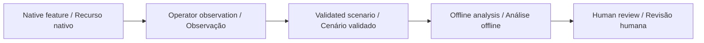

# Community Cargo Planner · Planejador de Materiais

[English](#english) · [Português](#português)

[](https://github.com/galafis/vbot-community-cargo-planner/actions/workflows/checks.yml)

## English

Plan supervised material-carrying exercises with a return reserve, round-trip distances, explicit measured parameters and an explainable payload/energy constrained selection.

**Status: working offline software prototype, synthetic examples, no physical validation.** Built specifically to investigate Vbot companion use within the capabilities the manufacturer permits. A standard unit without an open SDK is welcome.

### Try it

Node.js 22 or later. No packages, robot, account or API key required. After cloning, computation runs offline.

```sh
git clone https://github.com/galafis/vbot-community-cargo-planner.git
cd vbot-community-cargo-planner
npm test
npm run demo
npm run serve
```

Open `http://127.0.0.1:8765` for the English/Portuguese workbench. Edit the synthetic scenario, run the same engine used by the CLI and export the result. The server binds only to your own computer. Ctrl+C stops it. Use one workbench at a time on port 8765.

```sh
node cli.mjs examples/baseline.json new-result.json
```

Existing output files are refused. Exit 1 means invalid input or an I/O failure; exit 0 means analysis completed, including review findings. Do not infer suitability from the exit code.

### Implemented method

Enumerate all subsets of at most 20 items. Every selected item is a separate return trip. Total energy is base_Wh_per_m * round_trip_m + load_Wh_per_kg_m * kg * outbound_m + service_Wh. Payload includes the carrier. Maximize declared priority, then minimize energy, then use input order. Sensitivity recalculates with a higher base cost.

### Worked example

One 2 kg item 10 m away: round trip base energy 20 * 0.12 = 2.4 Wh; loaded outbound and carrier energy (2 + 2 * 0.5) * 10 * 0.02 = 0.6 Wh; service = 1 Wh. Total = 4 Wh. Budget = 100 * (0.8 - 0.25) = 55 Wh. Remaining charge = 80 - 4 = 76 Wh.

### Vbot relationship and limits

An educational planner for one out-and-back trip per item. Limits are operator study assumptions, never manufacturer ratings. No towing, medical delivery or robot navigation.

We can use native features, the official app and manually recorded observations. SDK access is optional; no bypass, reverse engineering or unsupported modification is planned. [Permitted workflow](docs/VBOT_WORKFLOW.md).



## Português

Planeje exercícios supervisionados de transporte de materiais com reserva de retorno, trajetos de ida e volta, parâmetros medidos e seleção explicável por carga e energia.

**Estado: protótipo funcional de software offline, exemplos fictícios, sem validação física.** Focado no estudo do Vbot conforme as capacidades permitidas pelo fabricante. Uma unidade comum sem SDK aberto é suficiente para iniciar.

### Experimentar

Execute os comandos acima com Node.js 22 ou superior. Não é necessário instalar dependências. Abra a bancada local e selecione Português. Edite o cenário, recalcule e exporte o resultado. Os testes e a linha de comando usam o mesmo motor da interface.

Planejamento didático de viagens independentes de ida e volta. Limites do cenário são hipóteses de estudo e precisam de medição; não são especificações garantidas do fabricante.

Podemos trabalhar com funções nativas, aplicativo oficial e observações manuais. Acesso por SDK é opcional. Veja o [fluxo permitido](docs/VBOT_WORKFLOW.md) e a [validação](docs/VALIDATION.md). Os resultados demonstram comportamento do software; benefícios sociais e desempenho físico ainda precisam ser estudados.

## Documentation · Documentação

- [Input contract and method · Contrato e método](docs/METHOD.md)
- [Validation and reproducibility · Validação](docs/VALIDATION.md)
- [Vbot workflow · Fluxo Vbot](docs/VBOT_WORKFLOW.md)
- [Study plan · Plano de estudo](docs/STUDY_PLAN.md)
- [Synthetic input · Entrada fictícia](examples/baseline.json)
- [Expected output · Saída esperada](examples/expected.json)

Independent work by [Gabriel Demetrios Lafis](https://www.linkedin.com/in/gabriel-demetrios-lafis/) · [Existing robotics portfolio](https://github.com/galafis#robotics). Vbot is a third-party product/brand; this repository is not an official SDK or vendor endorsement.
