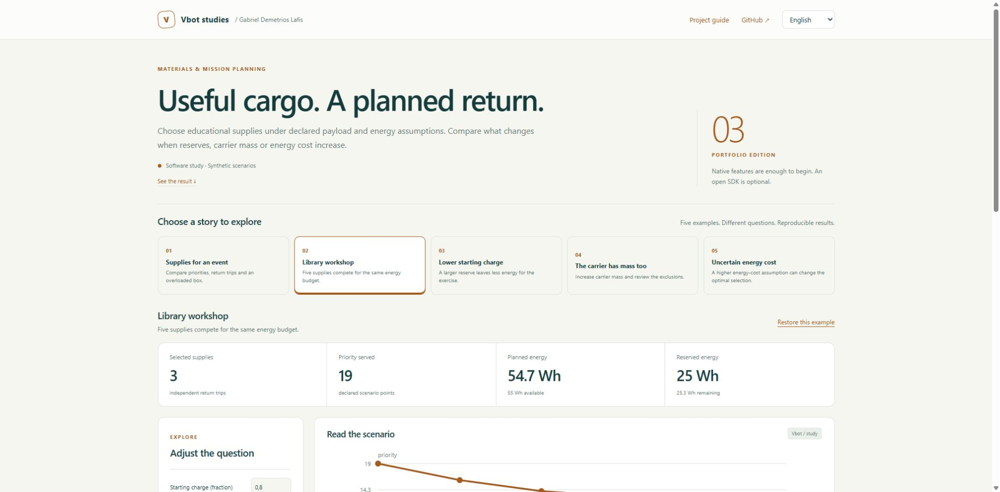
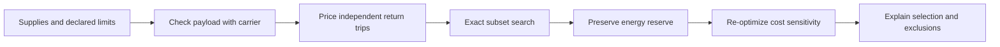

<p align="center"></p>

<h1 align="center">Community Cargo Planner</h1>

<p align="center"><strong>Useful cargo. A planned return.</strong><br>Materiais úteis. Retorno planejado.</p>

<p align="center">
<a href="https://github.com/galafis/vbot-community-cargo-planner/actions/workflows/checks.yml"></a>


</p>

<p align="center"><a href="https://galafis.github.io/vbot-community-cargo-planner/?lang=en"><strong>Open the interactive study</strong></a> · <a href="https://galafis.github.io/vbot-community-cargo-planner/?lang=pt"><strong>Abrir estudo em português</strong></a> · <a href="docs/DEMO.md">Guided walkthrough</a> · <a href="docs/EXPERIMENTS.md">Reproduce the examples</a></p>

[](https://galafis.github.io/vbot-community-cargo-planner/?lang=en&example=library-outreach)

[English](#english) · [Português](#português)

## English

Choose educational supplies under declared payload and energy assumptions. Compare what changes when reserves, carrier mass or energy cost increase.

**Research question:** Which independent return trips maximize declared priority without spending the return reserve?

This is a working, independent software study for a proposed Vbot companion-robotics program. You can run every example without a robot, account, package installation or API key. Physical validation has not been performed.

### Explore in one minute

1. [Open **Library workshop**](https://galafis.github.io/vbot-community-cargo-planner/?lang=en&example=library-outreach).
2. Inspect the chart and the explanation below it. The starting result is **3 supplies · 54.72/55 Wh · 19 priority**.
3. Adjust a control or select a contrasting example. Download a printable HTML report, a CSV evidence table or the full JSON analysis.

[View a portable example report](https://galafis.github.io/vbot-community-cargo-planner/examples/sample-report.html).

The JSON editor is available under **Advanced**; the main study uses guided controls.

### What you can investigate

- Exact subset selection for up to 20 items, rather than a greedy priority ranking.
- Payload includes the carrier; energy includes outbound payload and the empty return.
- Explicit starting charge and return reserve with independent out-and-back trips.
- Six cost-sensitivity points that re-optimize the selection at each point.
- Item-level exclusion reasons distinguish overload from energy/priority tradeoffs.

All five studies include a responsive English/Portuguese interface, keyboard focus styles, synthetic narrated examples and local report exports. Analysis runs in your browser after the page loads.

### Five examples, five questions

| Example                                                                                                             | Question it exposes                                               | Reproducible core result               |
| ------------------------------------------------------------------------------------------------------------------- | ----------------------------------------------------------------- | -------------------------------------- |
| [Supplies for an event](https://galafis.github.io/vbot-community-cargo-planner/?lang=en&example=baseline)           | Compare priorities, return trips and an overloaded box.           | 2 supplies · 51.8/55 Wh · 12 priority  |
| [Library workshop](https://galafis.github.io/vbot-community-cargo-planner/?lang=en&example=library-outreach)        | Five supplies compete for the same energy budget.                 | 3 supplies · 54.72/55 Wh · 19 priority |
| [Lower starting charge](https://galafis.github.io/vbot-community-cargo-planner/?lang=en&example=low-charge)         | A larger reserve leaves less energy for the exercise.             | 1 supply · 12.6/15 Wh · 6 priority   |
| [The carrier has mass too](https://galafis.github.io/vbot-community-cargo-planner/?lang=en&example=carrier-mass)    | Increase carrier mass and review the exclusions.                  | 3 supplies · 40.9/55 Wh · 13 priority  |
| [Uncertain energy cost](https://galafis.github.io/vbot-community-cargo-planner/?lang=en&example=energy-uncertainty) | A higher energy-cost assumption can change the optimal selection. | 2 supplies · 53.12/55 Wh · 14 priority |

These are deterministic scenario results, not field measurements. [Experiment notes](docs/EXPERIMENTS.md) distinguish expected regression outputs from independent arithmetic and failure-case tests.

### Run locally

Install Node.js 22 or newer. No npm dependencies are required.

```sh
git clone https://github.com/galafis/vbot-community-cargo-planner.git
cd vbot-community-cargo-planner
npm run serve
```

Open **http://127.0.0.1:8765**. The local server binds to your computer only. Stop with Ctrl+C. For another port, use `node server.mjs 8766`.

```sh
npm run check                                  # syntax, domain tests, examples and server checks
node cli.mjs examples/library-outreach.json            # core analysis
node study.mjs examples/library-outreach.json          # analysis plus derived insights
node cli.mjs examples/baseline.json new-result.json
```

The CLI refuses to overwrite an existing output file. Exit 1 means invalid input or an I/O failure; review findings are valid analytical outputs and do not change the exit code.

### How the study works



**Method:** Exact subset optimization with carrier mass, return trips and sensitivity. The core engine and the insight layer are pure local calculations shared by browser and CLI. [Architecture](docs/ARCHITECTURE.md) · [Domain method](docs/METHOD.md) · [Input contract](docs/DATA_CONTRACT.md).

### Evidence and scope

| Evidence available now                                                         | Next evidence needed                                                  |
| ------------------------------------------------------------------------------ | --------------------------------------------------------------------- |
| 19 automated tests, five reproducible fixtures and a real interface screenshot | Measurements from a specific supplied Vbot unit                       |
| Deterministic calculations and explicit counterexamples                        | Repeated permitted exercises with operator observations               |
| Bilingual methods, reports and example inputs                                  | Appropriate authorization before institutional or participant studies |

**A standard Vbot without an open SDK is welcome.** The proposed first hardware stage uses native features, the official app and manual observations. Any later programmatic integration is optional and must be permitted by the manufacturer. [Native workflow](docs/VBOT_WORKFLOW.md) · [90-day study plan](docs/STUDY_PLAN.md).

### Project map

```text
src/        Pure domain engine, contracts and derived insights
examples/   Five narrated inputs and reproducible expected outputs
app.mjs     Guided bilingual browser workbench
styles.css  Responsive, printable visual system
cli.mjs     Core analysis from a local JSON file
study.mjs   Complete study from a local JSON file
tests/      Domain, insight, reproduction and HTTP checks
docs/       Walkthrough, experiments, method and study plan
```

## Português

Escolha materiais educacionais considerando hipóteses explícitas de carga e energia. Compare o efeito da reserva, do suporte e do consumo.

**Pergunta do estudo:** Quais viagens independentes maximizam a prioridade sem consumir a reserva de retorno?

O projeto está pronto para exploração em software. Os exemplos são fictícios e a validação física ainda depende de uma unidade. Uma unidade comum, sem SDK aberto, é suficiente para iniciar a fase proposta com recursos nativos e observação manual.

### Comece por um exemplo concreto

[Abra **Oficina na biblioteca**](https://galafis.github.io/vbot-community-cargo-planner/?lang=pt&example=library-outreach). O resultado inicial é **3 materiais · 54.72/55 Wh · 19 pontos**. Observe o gráfico, mude um parâmetro ou escolha outro cenário. A interface explica os resultados e exporta relatório HTML imprimível, tabela CSV e análise JSON.

### Funcionalidades

- Seleção exata de subconjuntos com até 20 materiais.
- O suporte entra na carga e na energia; o retorno vazio também é calculado.
- Carga inicial e reserva explícitas, com viagens independentes de ida e volta.
- Seis pontos de sensibilidade recalculam a seleção quando o consumo aumenta.
- Motivos por material distinguem excesso de carga de compromisso entre energia e prioridade.

### Exemplos disponíveis

| Exemplo                                                                                                           | O que permite examinar                                          | Resultado reproduzível                |
| ----------------------------------------------------------------------------------------------------------------- | --------------------------------------------------------------- | ------------------------------------- |
| [Materiais para um evento](https://galafis.github.io/vbot-community-cargo-planner/?lang=pt&example=baseline)      | Compare prioridade, retorno e uma caixa que excede a carga.     | 2 materiais · 51.8/55 Wh · 12 pontos  |
| [Oficina na biblioteca](https://galafis.github.io/vbot-community-cargo-planner/?lang=pt&example=library-outreach) | Cinco materiais concorrem pelo mesmo orçamento de energia.      | 3 materiais · 54.72/55 Wh · 19 pontos |
| [Carga inicial reduzida](https://galafis.github.io/vbot-community-cargo-planner/?lang=pt&example=low-charge)      | Uma reserva maior deixa menos energia disponível para a missão. | 1 material · 12.6/15 Wh · 6 pontos   |
| [O suporte também pesa](https://galafis.github.io/vbot-community-cargo-planner/?lang=pt&example=carrier-mass)     | Aumente a massa do suporte e reveja as exclusões.               | 3 materiais · 40.9/55 Wh · 13 pontos  |
| [Consumo incerto](https://galafis.github.io/vbot-community-cargo-planner/?lang=pt&example=energy-uncertainty)     | Uma hipótese de consumo maior pode mudar a seleção ótima.       | 2 materiais · 53.12/55 Wh · 14 pontos |

### Executar e contribuir

Use os comandos da seção em inglês com Node.js 22 ou superior. Não é necessário instalar pacotes. `npm run check` executa verificações de sintaxe, testes e reprodução dos cenários. O guia [DEMO](docs/DEMO.md) explica um percurso de exploração; [EXPERIMENTS](docs/EXPERIMENTS.md) registra os resultados e suas limitações.

Sugestões úteis incluem novos cenários fictícios, cálculos independentes, melhorias de acessibilidade da interface e protocolos de observação autorizados. Veja [CONTRIBUTING](CONTRIBUTING.md).

## Study collection · Coleção de estudos

[01 · Companion Follow Lab](https://github.com/galafis/vbot-accessible-follow-lab) · [02 · Portuguese Interaction Bench](https://github.com/galafis/vbot-ptbr-interaction-bench) · [03 · Community Cargo Planner](https://github.com/galafis/vbot-community-cargo-planner) · [04 · Inclusive Encounter Kit](https://github.com/galafis/vbot-inclusive-encounter-kit) · [05 · Community Observation Lab](https://github.com/galafis/vbot-community-observation-lab)

---

Created by **[Gabriel Demetrios Lafis](https://www.linkedin.com/in/gabriel-demetrios-lafis/)** · [Applied AI and robotics portfolio](https://github.com/galafis#robotics)

MIT-licensed independent work. Vbot is a third-party brand; this is not an official SDK or an announced Vbot/USP partnership.
